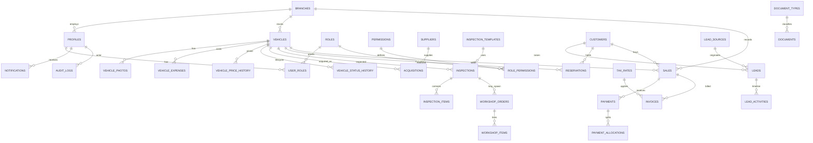

# Zohaan Motors — Database Architecture (Phase 3)

> This is the historical Phase 3 design; subsequent migrations change it, including
> Workshop removal. For current definitions use `src/lib/db/schema/`, the
> [Drizzle workflow](database-workflow.md), and the [current ERD](database-erd.md).

This document describes the Supabase PostgreSQL schema created in Phase 3. Business UI modules and full RBAC/RLS policies are intentionally deferred to later phases.

## Goals

Support the dealership lifecycle:

```text
Acquisition → Inspection → Repair → Ready for sale
→ Lead → Test drive → Reservation → Sale → Payment → Delivery
```

Primary market: UAE. Primary currency: AED. Timestamps: UTC (`timestamptz`).

## Architecture decisions

| Topic | Decision |
| --- | --- |
| Money | `numeric(14,2)` only. Never float/double. |
| IDs | UUID primary keys via `gen_random_uuid()`. |
| Auth | Supabase Auth owns credentials. `profiles.id` = `auth.users.id`. |
| Expenses | Single `vehicle_expenses` ledger. Optional `acquisition_id`. No duplicate `acquisition_expenses` table. |
| Payments | Booking deposits and sale payments are recorded on `reservations` / `sales`. The unused `payments`, `payment_allocations`, `invoices` and `tax_rates` tables were dropped in 00063. |
| Soft delete | `deleted_at` / `deleted_by` on vehicles, customers, documents, profiles. |
| Financial voiding | Sales and reservations use status (`cancelled`, `refunded`, …). Do not hard-delete. |
| Emirates | PostgreSQL enum `uae_emirate` (single source of truth). |
| Document types | Lookup table (seeded), not enums — business can add values. |
| Reservation integrity | Partial unique index: one `status = 'active'` reservation per `vehicle_id`. Trigger blocks active reservations when vehicle is `sold` / `delivered` / `archived`. |
| Sale integrity | Partial unique index: one non-cancelled sale per vehicle. |
| Storage | Private buckets only. Metadata in Postgres; binaries in Storage. |
| RLS | Enabled on all business tables. Deny-by-default except own profile/notifications bootstrap. Phase 4 adds permission policies. |
| Audit | Selective triggers on vehicles, acquisitions, reservations, sales, profiles, roles, user_roles. Plus automatic vehicle status history. |

## Migration layout

```text
supabase/
├── config.toml
├── seed.sql
├── migrations/
│   ├── 00001_extensions.sql
│   ├── 00002_enums.sql
│   ├── 00003_common_functions.sql
│   ├── 00004_branches.sql
│   ├── 00005_profiles.sql
│   ├── 00006_rbac.sql
│   ├── 00007_vehicles.sql
│   ├── 00008_vehicle_related.sql
│   ├── 00009_acquisitions.sql
│   ├── 00010_inspections.sql
│   ├── 00011_workshop.sql
│   ├── 00012_customers.sql
│   ├── 00013_leads.sql
│   ├── 00014_reservations.sql
│   ├── 00015_sales.sql
│   ├── 00016_payments.sql
│   ├── 00017_invoices_tax.sql
│   ├── 00018_documents.sql
│   ├── 00019_notifications.sql
│   ├── 00020_audit_logs.sql
│   ├── 00021_indexes.sql
│   ├── 00022_functions_triggers.sql
│   ├── 00023_storage.sql
│   ├── 00024_rls_foundation.sql
│   ├── 00025_auth_helpers.sql
│   ├── 00026_role_permission_mappings.sql
│   ├── 00027_rls_policies.sql
│   └── 00028_storage_security.sql
└── tests/
    ├── constraint_checks.sql
    └── rls_security_checks.sql
```

## Apply migrations

Local Docker is preferred when available:

```bash
npx supabase start
npx supabase db reset   # migrations + seed
npx supabase gen types typescript --local > src/types/database.ts
```

Against the linked remote project (requires login + database password):

```bash
npx supabase link --project-ref <project-ref>
npx supabase db push
npx supabase db query -f supabase/seed.sql
npx supabase gen types typescript --linked > src/types/database.ts
```

Constraint smoke test (rolls back):

```bash
psql "$DATABASE_URL" -f supabase/tests/constraint_checks.sql
```

## Tables

### Identity & access

- `branches` — showroom locations
- `profiles` — staff profiles (1:1 with `auth.users`)
- `roles`, `permissions`, `role_permissions`, `user_roles`

### Inventory

- `vehicles`
- `vehicle_expenses`
- `vehicle_status_history`
- `vehicle_photos`
- `suppliers`
- `acquisitions`

### CRM & sales

- `customers`
- `reservations` (bookings)
- `sales`

### Shared

- `document_types`, `documents`
- `notifications`
- `audit_logs`

## Enums

`uae_emirate`, `user_status`, `vehicle_status`, `vehicle_source`, `vehicle_condition`, `transmission_type`, `fuel_type`, `vehicle_origin`, `vehicle_expense_category`, `vehicle_photo_category`, `acquisition_status`, `inspection_status`, `inspection_result`, `inspection_item_result`, `workshop_status`, `workshop_priority`, `workshop_item_type`, `lead_status`, `lead_activity_type`, `reservation_status`, `sale_status`, `payment_status`, `payment_method`, `invoice_status`, `document_status`, `preferred_language`

Vehicle status values: `acquired`, `under_inspection`, `inspection_failed`, `under_repair`, `ready_for_sale`, `reserved`, `sold`, `delivered`, `returned`, `archived`.

## Important indexes

- Unique active `vehicles.stock_number` / `vehicles.vin`
- Unique active `customers.phone` / `customers.customer_code`
- One active reservation per vehicle
- One non-cancelled sale per vehicle
- One primary photo per vehicle
- FK and status indexes across inventory, CRM, and finance
- `pg_trgm` GIN indexes on vehicle make/model/stock and customer name/phone

## Functions & triggers

| Object | Purpose |
| --- | --- |
| `set_updated_at()` | Maintains `updated_at` on mutable tables |
| `handle_new_user()` | Creates `profiles` row on `auth.users` insert |
| `write_audit_log()` / `audit_row_change()` | Selective audit trail |
| `track_vehicle_status_change()` | Appends `vehicle_status_history` |
| `enforce_reservation_vehicle_state()` | Blocks active reservations on sold/delivered/archived vehicles |

## Seed data

Reference data only:

- System roles (Super Admin → Viewer)
- Permission catalog and Super Admin / Admin / Viewer mappings
- Document types
- Optional demo branch `DXB-01`

No fake customers, sales, or payments.

## Storage

Private buckets:

| Bucket | Use |
| --- | --- |
| `vehicle-photos` | Inventory photography |
| `vehicle-documents` | Registration, customs, purchase docs |
| `customer-documents` | Customer uploads |
| `sales-documents` | Sale contracts / invoices files |

Authenticated read/write policies are temporary and will be tightened in Phase 4. Public anonymous access is not allowed.

## Branch strategy

Direct `branch_id` on vehicles, acquisitions, reservations, sales, and optionally customers/documents. Profiles and `user_roles.branch_id` prepare scoped RBAC in Phase 4.

## ER diagram



## Phase 4 status

Phase 4 (Authentication, RBAC, RLS) is implemented. See:

- [security.md](./security.md)
- [rbac-matrix.md](./rbac-matrix.md)
- [rls.md](./rls.md)
